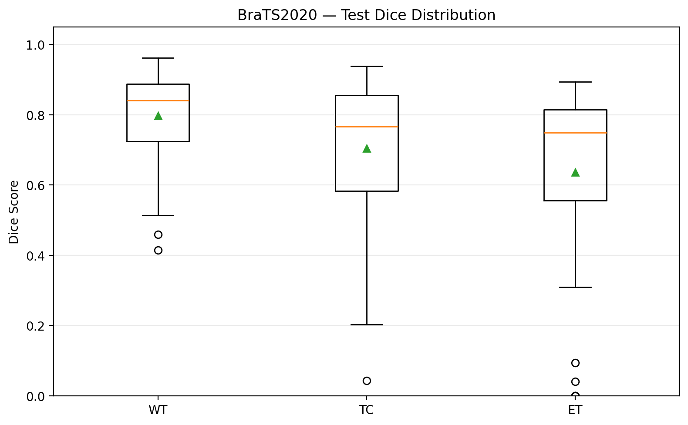
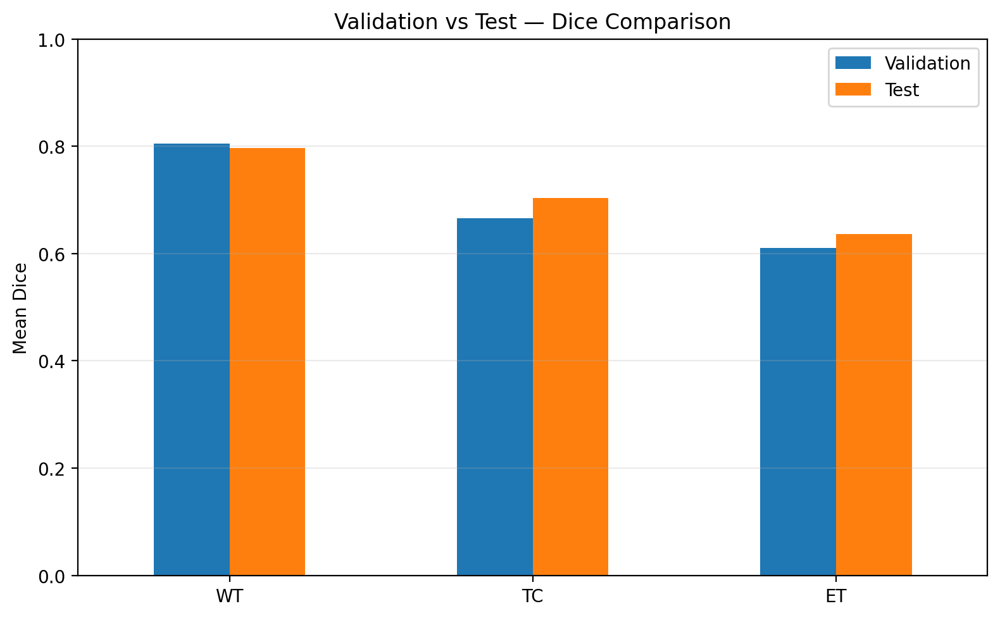
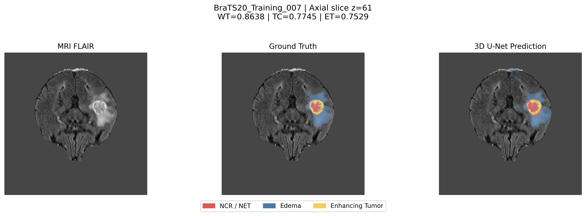

# BraTS2020 Brain Tumor Segmentation - 3D U-Net Baseline

Brain tumor segmentation from multimodal 3D MRI using **PyTorch** and **MONAI**. This repository contains the preprocessing pipeline, a 3D U-Net baseline, training and evaluation modules, notebooks, and results from a completed 10-epoch experiment on BraTS2020.

> **Project status:** Baseline experiment completed and evaluated. Modular components passed synthetic-data integration smoke tests. The released repository does **not** include the MRI dataset or trained checkpoints.

## 1. Dataset and experimental split

The experiment uses the **BraTS2020 training data**, with four MRI modalities per subject:

| Input channel | Modality |
|---|---|
| 1 | T1 |
| 2 | T1ce (contrast-enhanced T1) |
| 3 | T2 |
| 4 | FLAIR |

The original segmentation labels `{0, 1, 2, 4}` are remapped to `{0, 1, 2, 3}` for four-class training. The MRI images and masks are loaded from NIfTI files.

The fixed patient-level split (seed 42) is recorded in [`splits/split_manifest_seed42.csv`](splits/split_manifest_seed42.csv):

| Partition | Subjects | Purpose |
|---|---:|---|
| Train | 257 | Model optimization |
| Internal validation | 55 | Checkpoint selection |
| Held-out test | 56 | Final evaluation only |
| **Total** | **368** | |

One subject was excluded during data preparation because of an unusual segmentation file. **The held-out test set is an internal split of labeled BraTS2020 training subjects, not the official challenge test set.** Its labels are used only for final evaluation. The official BraTS2020 validation dataset is not used as the labeled internal validation set in this experiment.

Data were accessed on Kaggle as `awsaf49/brats20-dataset-training-validation`. Download or attach the dataset separately in accordance with its terms; the MRI files are not redistributed in this repository.

## 2. Preprocessing and prediction targets

1. Load T1, T1ce, T2 and FLAIR volumes and check spatial shape and affine consistency.
2. Apply **foreground-only z-score normalization** independently to each modality; zero-valued background voxels remain zero.
3. Remap segmentation label `4` to `3`.
4. During training, sample one random **96 × 96 × 96** patch per subject access, choosing a tumor-positive center with probability `0.5` when available.
5. During validation and testing, perform full-volume sliding-window inference using **96³** windows, **25% overlap**, Gaussian blending and CPU-side output aggregation.

Evaluation follows three overlapping BraTS regions (using remapped labels):

| Region | Description | Labels |
|---|---|---|
| WT | Whole Tumor | `{1, 2, 3}` |
| TC | Tumor Core | `{1, 3}` |
| ET | Enhancing Tumor | `{3}` |

Dice for a region is calculated for each patient as `2 × intersection / (prediction voxels + ground-truth voxels)`, and reported as the **mean across subjects (macro average)**. If both region masks are empty, Dice is defined as `1`; if only one is empty, Dice is `0`.

## 3. Baseline model and training

| Setting | Configuration |
|---|---|
| Architecture | MONAI 3D U-Net |
| Input / output channels | 4 / 4 |
| Feature channels | `(16, 32, 64, 128)` |
| Strides | `(2, 2, 2)` |
| Residual units | 2 per level |
| Normalization | Instance normalization |
| Trainable parameters | **1,191,413** |
| Loss | MONAI DiceCELoss (without background in Dice term) |
| Optimizer | AdamW |
| Learning rate | `1e-4` |
| Patch size / batch size | `96³` / `1` |
| Training | **10 epochs**, 257 training patches per epoch |
| Validation interval | Every 5 epochs |
| Mixed precision | CUDA FP16 AMP, GradScaler |
| Gradient clipping | Max norm `12.0` when gradients are finite |
| Checkpoint selection | Best mean validation Dice across WT, TC and ET |

The training engine skips optimizer updates on detected AMP gradient overflow while preserving training statistics. In the recorded 10-epoch experiment, there were two skipped optimizer steps. Checkpoints include model, optimizer and GradScaler states as well as progress metadata.

## 4. Experimental results

The best model was selected at **epoch 10**, using the 55-subject internal validation set. Final held-out testing was then performed on 56 previously unseen subjects.

| Metric | Internal validation (55) | Held-out test (56) |
|---|---:|---:|
| WT Dice | 0.8047 | **0.7964** |
| TC Dice | 0.6658 | **0.7036** |
| ET Dice | 0.6099 | **0.6363** |
| **Mean Dice** | **0.6934** | **0.7121** |

The table reports **subject-level macro-averaged Dice**, not global voxel-aggregated Dice. The mean Dice is the arithmetic mean of WT, TC and ET macro Dice. These results describe this specific internal split and should not be interpreted as official BraTS2020 leaderboard scores.

### Error analysis

- WT scores were generally higher and more consistent than TC and ET scores.
- The model struggled with some small or difficult tumor-core regions; for example, subject `BraTS20_Training_280` had a TC Dice of approximately `0.0432`.
- Four test subjects had no ground-truth ET. The model predicted some ET voxels in each, yielding ET Dice `0` under the evaluation convention used here.
- On the 52 test subjects with ground-truth ET, the mean ET Dice was approximately `0.6853`.

Analysis of held-out cases is **descriptive only**; their results were not used to change the model or select hyperparameters.

### Figures

**Distribution of held-out Dice scores**



**Internal validation versus held-out test**



**Example segmentation - BraTS20_Training_007**



Additional examples: [TC error analysis, subject 280](results/figures/BraTS20_Training_280_error_analysis.png) and [ET false-positive analysis, subject 268](results/figures/BraTS20_Training_268_ET_false_positive.png). Slice visualizations are illustrative; reported Dice values are computed over full 3D volumes.

The CSV/JSON outputs can be found under [`results/metrics/`](results/metrics/), including training history, validation predictions and Dice scores for each of the 56 test subjects.

## 5. Repository structure

```text
notebooks/
  01_data_exploration.ipynb       # Explore BraTS2020 data
  02_data_pipeline.ipynb          # Validate preprocessing and splits
  03_baseline_training.ipynb      # Training, validation and test pipeline
  04_integration_smoke_test.ipynb # Synthetic-data module checks
src/
  data/
    preprocessing.py
    dataset.py
    patches.py
  models/
    unet3d.py
  training/
    engine.py
    checkpoints.py
  evaluation/
    metrics.py
    validation.py
splits/
  split_manifest_seed42.csv
results/
  metrics/                        # CSV/JSON experimental outputs
  figures/                        # Plots and qualitative examples
README.md
```

## 6. Running the project

### Recommended: Kaggle

1. Create a Kaggle notebook with a CUDA-capable GPU and attach the BraTS2020 data matching the split manifest.
2. Install MONAI and import the dependencies used in the notebooks (PyTorch, NumPy, pandas, NiBabel and Matplotlib).
    ```bash
   python -m pip install -r requirements.txt
   ```
3. Clone branch `refactor/data-pipeline`:

   ```bash
   git clone --branch refactor/data-pipeline --single-branch https://github.com/tthanh81/brats2020-segmentation.git
   ```

4. Review [`notebooks/03_baseline_training.ipynb`](notebooks/03_baseline_training.ipynb). Its original Kaggle configuration expects:

   ```text
   /kaggle/working/brats2020-segmentation
   /kaggle/input/datasets/awsaf49/brats20-dataset-training-validation
   ```

   If your Kaggle mount path differs, **edit `DATA_ROOT`** accordingly. The notebook checks that all referenced subject files exist.

5. **The notebook defaults to `RUN_TRAINING=False`, `RUN_TEST=False`, `RUN_FIGURES=False`** to avoid unintentionally launching expensive jobs. Only enable the intended stages once dataset, output paths and checkpoint availability are verified. To resume training, the checkpoint and matching training history are required.
6. For fast independent checks without MRI data, use [`notebooks/04_integration_smoke_test.ipynb`](notebooks/04_integration_smoke_test.ipynb). Its tests cover imports, Dice, model forward/loss, two synthetic training batches, checkpoint round-trip and synthetic sliding-window validation.

**Environment note:** The module smoke tests passed on Kaggle with Python `3.13.15`, PyTorch `2.11.0+cu128`, MONAI `1.6.1`, Tesla T4 and repository commit `5d7ce7d`. These identify the **integration test environment**, not necessarily the exact package versions used for the original 10-epoch training run. A full reproduction of the reported scores has not been carried out after the modular refactor.

### Pretrained weights and data availability

The trained `best.pt` / `latest.pt` checkpoints are stored in a separate project backup, **not** in GitHub. To evaluate the trained model, place the compatible checkpoint under the run's `checkpoints/` folder and provide the original MRI dataset. A fresh clone alone cannot regenerate the reported test scores without training or supplying a pretrained checkpoint.

## 7. Limitations and next steps

- Evaluation uses one fixed internal patient-level split; external-site and official challenge testing have not been established.
- Enhancing Tumor predictions can contain false positives when ground-truth ET is absent.
- Experiment-level reproducibility still depends on the dataset mount, checkpoints and environment versions.
- Further architectures (for example, Swin UNETR) are potential future work, **not completed results in this baseline**.

This is a research/educational project; its predictions are **not intended for clinical use**.
