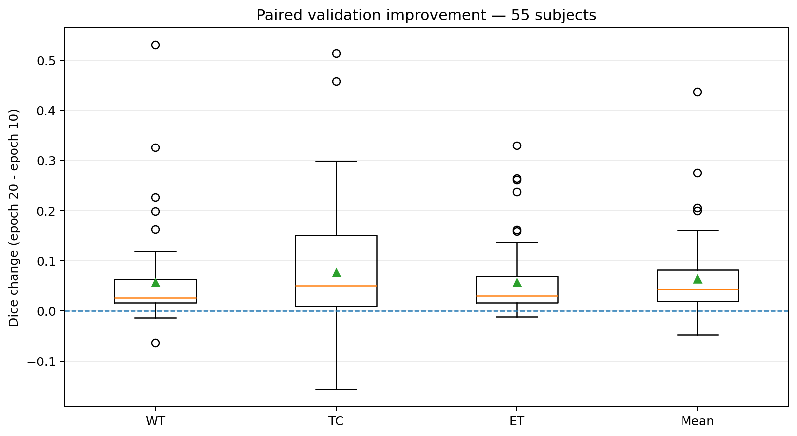

# BraTS2020 Brain Tumor Segmentation - 3D U-Net

Brain tumor segmentation from multimodal 3D MRI using **PyTorch** and **MONAI**.

This repository contains an end-to-end deep learning pipeline for brain tumor segmentation, including data preprocessing, patient-level dataset splitting, 3D U-Net training, full-volume inference, evaluation, error analysis, and experimental improvements.

The project includes two completed training experiments:

- **Baseline:** A 3D U-Net trained for 10 epochs.
- **Extended training:** The same model resumed from epoch 10 and trained through epoch 20.

The extended-training experiment achieved a **mean internal validation Dice of 0.757544**, compared with **0.693434** for the 10-epoch baseline.

> **Project status:** Both training experiments and their internal validation analyses are complete. The 10-epoch baseline has also been evaluated on an internal held-out test set. The 20-epoch model has not yet undergone held-out test evaluation.
>
> MRI datasets and trained model checkpoints are not distributed through this repository.

---

## 1. Project Overview

Brain tumor segmentation aims to identify different tumor subregions from magnetic resonance imaging (MRI).

This project uses the **BraTS2020** dataset and four MRI modalities:

| Input channel | MRI modality |
|---|---|
| 1 | T1-weighted (T1) |
| 2 | Contrast-enhanced T1 (T1ce) |
| 3 | T2-weighted (T2) |
| 4 | Fluid-Attenuated Inversion Recovery (FLAIR) |

The segmentation model predicts four voxel-level classes:

| Class | Description |
|---|---|
| 0 | Background |
| 1 | Necrotic and non-enhancing tumor core (NCR/NET) |
| 2 | Peritumoral edema (ED) |
| 3 | Enhancing tumor (ET) |

The original BraTS segmentation labels `{0, 1, 2, 4}` are remapped to `{0, 1, 2, 3}` for model training.

### Project objectives

1. Build a reproducible preprocessing and data-loading pipeline for multimodal 3D MRI.
2. Implement a 3D U-Net baseline using PyTorch and MONAI.
3. Train the segmentation model using patch-based learning.
4. Evaluate predictions using full-volume inference and Dice scores.
5. Analyze segmentation performance and failure cases.
6. Investigate whether extending training from 10 to 20 epochs improves segmentation performance.
7. Organize the experimental code, results, and documentation into a modular research repository.

---

## 2. Dataset and Data Splitting

### 2.1 Dataset

The project uses the labeled BraTS2020 training data.

The dataset was accessed on Kaggle through:

`awsaf49/brats20-dataset-training-validation`

Each subject includes four MRI modalities and a corresponding segmentation mask.

The original MRI volumes have a spatial size of approximately:

`240 × 240 × 155`

The model input contains four channels, resulting in full-volume tensors with shape:

`[4, 240, 240, 155]`

### 2.2 Patient-level split

A fixed patient-level split was generated using random seed **42**.

The split manifest is available at:

[`splits/split_manifest_seed42.csv`](splits/split_manifest_seed42.csv)

| Dataset partition | Number of subjects | Purpose |
|---|---:|---|
| Training | 257 | Model optimization |
| Internal validation | 55 | Checkpoint selection and experimental comparison |
| Held-out test | 56 | Independent final evaluation |
| **Total** | **368** | |

One subject was excluded during preprocessing because of an unusual segmentation file.

The same training and validation subjects were used in both the baseline and extended-training experiments.

**Important:** The held-out test set is an internal split of labeled BraTS2020 training subjects. It is not the official BraTS2020 challenge test set.

The official challenge validation dataset was not used as the labeled internal validation set in this project.

The MRI dataset is not included in the repository and must be downloaded or attached separately.

---

## 3. Data Preprocessing

### 3.1 MRI loading and verification

MRI images and segmentation masks are loaded from NIfTI files.

The pipeline verifies:

- Availability of the required MRI modalities.
- Spatial shape consistency.
- Affine consistency.
- Segmentation label validity.

### 3.2 Intensity normalization

Each MRI modality is normalized independently using **foreground-only z-score normalization**.

For foreground voxels:

\[
x_{\text{normalized}} = \frac{x-\mu}{\sigma}
\]

where:

- \(\mu\) is the mean foreground intensity.
- \(\sigma\) is the foreground intensity standard deviation.

Zero-valued background voxels remain zero.

### 3.3 Segmentation label remapping

The original BraTS labels are converted using:

```python
label[label == 4] = 3
```

The resulting labels are:

`{0, 1, 2, 3}`

### 3.4 Patch-based training

Training uses randomly sampled 3D patches with spatial size:

`96 × 96 × 96`

The sampling strategy uses a tumor-positive patch center with probability:

`POS_PROB = 0.5`

This encourages the model to observe tumor regions while retaining randomly sampled patches.

A training epoch contains **257 batches**, corresponding to one patch-dataset access per training subject.

### 3.5 Full-volume validation and testing

Validation and testing are performed on complete MRI volumes rather than randomly sampled training patches.

Inference settings:

| Parameter | Value |
|---|---|
| Method | MONAI sliding-window inference |
| ROI size | `96 × 96 × 96` |
| Overlap | `0.25` |
| Window blending | Gaussian |
| Window batch size | 1 |
| Output aggregation | CPU |

This approach reduces GPU memory requirements while allowing predictions over the entire MRI volume.

---

## 4. Model Architecture and Training Configuration

### 4.1 Architecture

The baseline model uses a MONAI **3D U-Net**.

| Component | Configuration |
|---|---|
| Architecture | MONAI 3D U-Net |
| Spatial dimensions | 3 |
| Input channels | 4 |
| Output classes | 4 |
| Feature channels | `(16, 32, 64, 128)` |
| Strides | `(2, 2, 2)` |
| Residual units | 2 |
| Normalization | Instance Normalization |
| Trainable parameters | **1,191,413** |

The architecture is shared by the baseline and extended-training experiments.

### 4.2 Training configuration

| Hyperparameter | Value |
|---|---|
| Loss function | MONAI DiceCELoss |
| Optimizer | AdamW |
| Learning rate | `1e-4` |
| Batch size | 1 |
| Patch size | `96 × 96 × 96` |
| Positive-center probability | 0.5 |
| DataLoader workers | 2 |
| Mixed precision | CUDA FP16 AMP |
| Gradient scaling | GradScaler |
| Gradient clipping | Maximum norm 12.0 |
| Random seed | 42 |
| Validation interval | Every 5 epochs |

The Dice component of the loss excludes the background class.

### 4.3 AMP-safe training

The training engine handles non-finite gradients during mixed-precision training.

When gradient overflow is detected:

1. Gradient clipping is skipped for non-finite gradients.
2. GradScaler handles the overflow.
3. The affected optimizer update is skipped.
4. The AMP scale is adjusted.
5. Training statistics record the skipped step.

This mechanism was used in the completed baseline and extended-training experiments.

### 4.4 Checkpoint management

Two checkpoints are maintained:

- `latest.pt`: The most recently completed training epoch.
- `best.pt`: The checkpoint achieving the highest mean internal validation Dice.

Checkpoints include:

- Model state.
- Optimizer state.
- GradScaler state.
- Completed epoch.
- Global optimizer step.
- Best validation Dice.
- Training configuration.
- PyTorch CPU and CUDA RNG states.

The checkpoints are stored separately from GitHub.

---

## 5. Evaluation Metrics

The project evaluates three overlapping BraTS tumor regions.

| Region | Description | Remapped labels |
|---|---|---|
| WT | Whole Tumor | `{1, 2, 3}` |
| TC | Tumor Core | `{1, 3}` |
| ET | Enhancing Tumor | `{3}` |

The Dice Similarity Coefficient is:

\[
\mathrm{Dice}(P,G)=\frac{2|P\cap G|}{|P|+|G|}
\]

where:

- \(P\) is the predicted region.
- \(G\) is the ground-truth region.

Dice is calculated separately for each tumor region and each patient.

The reported region Dice is the **macro average across patients**.

The overall mean Dice is the arithmetic mean of the WT, TC, and ET macro Dice scores.

### Empty-mask convention

- Both prediction and ground truth are empty: Dice = 1.
- Exactly one mask is empty: Dice = 0.

This convention is important when interpreting the ET results of patients without enhancing tumor.

---

## 6. Experiment 1 - Baseline Training (10 Epochs)

### 6.1 Experimental setup

The baseline model was trained for 10 epochs using the fixed patient-level split.

Validation was performed at epochs 5 and 10.

The checkpoint achieving the highest mean validation Dice was selected for final held-out evaluation.

The selected baseline checkpoint was **epoch 10**.

### 6.2 Baseline results

| Metric | Internal validation (55) | Held-out test (56) |
|---|---:|---:|
| WT Dice | 0.804653 | 0.7964 |
| TC Dice | 0.665765 | 0.7036 |
| ET Dice | 0.609885 | 0.6363 |
| **Mean Dice** | **0.693434** | **0.7121** |

All reported values use subject-level macro-averaged Dice.

The held-out test results were obtained using the best baseline checkpoint selected from internal validation.

They are not official BraTS2020 leaderboard scores.

### 6.3 Training behavior

The training loss decreased from approximately **1.9649** at epoch 1 to **0.7205** at epoch 10.

The final baseline run recorded:

- Completed epochs: 10.
- Successful optimizer steps: 2,568.
- AMP-skipped optimizer steps: 2.
- Best validation epoch: 10.
- Best mean validation Dice: 0.693434.

### 6.4 Baseline error analysis

The original baseline evaluation identified several limitations.

**Whole Tumor (WT)** generally achieved higher Dice scores than Tumor Core (TC) and Enhancing Tumor (ET).

Some subjects exhibited severe errors in difficult tumor-core regions. For example:

`BraTS20_Training_280`

had a TC Dice of approximately **0.0432**.

The baseline also produced ET false positives in patients without ground-truth ET.

Four held-out test subjects had no ground-truth ET, but the model predicted ET voxels in each case, resulting in ET Dice scores of zero under the evaluation convention used.

Among the 52 held-out test subjects with ground-truth ET, mean ET Dice was approximately **0.6853**.

These held-out test observations are descriptive. They were not used to choose the extended-training checkpoint.

### 6.5 Baseline visualizations

**Held-out test Dice distribution**


**Validation versus held-out test**


**Example prediction - BraTS20_Training_007**


Additional examples:

- [Tumor Core error analysis - Subject 280](results/figures/BraTS20_Training_280_error_analysis.png)
- [ET false-positive analysis - Subject 268](results/figures/BraTS20_Training_268_ET_false_positive.png)

The figures show selected MRI slices for interpretation, while Dice metrics are calculated using the full 3D volumes.

---

## 7. Experiment 2 - Extended Training (20 Epochs)

### 7.1 Motivation

The baseline model continued to show decreasing training loss at epoch 10.

The extended-training experiment investigated whether additional training would improve tumor segmentation performance without changing the model architecture or the main training hyperparameters.

### 7.2 Experimental design

The model was resumed from the completed **epoch-10 checkpoint** and trained through epoch 20.

The experiment preserved:

- The same 3D U-Net architecture.
- The same training and internal validation splits.
- The same preprocessing pipeline.
- The same patch size and sampling probability.
- The same loss function.
- The same AdamW optimizer and learning rate.
- The same full-volume validation procedure.

The model, optimizer, and GradScaler states were restored from the baseline checkpoint.

PyTorch RNG states were also restored at the beginning of the resumed experiment. However, exact batch-by-batch reproduction is not guaranteed because complete DataLoader worker and other random states were not preserved.

The validation checkpoints were evaluated at epochs **15 and 20**.

The held-out test set was not used to select the extended-training checkpoint.

### 7.3 Validation results

| Metric | Epoch 10 | Epoch 15 | Epoch 20 |
|---|---:|---:|---:|
| WT Dice | 0.804653 | 0.814428 | **0.861699** |
| TC Dice | 0.665765 | 0.679219 | **0.743321** |
| ET Dice | 0.609885 | 0.644341 | **0.667613** |
| **Mean Dice** | **0.693434** | **0.712662** | **0.757544** |

The best checkpoint was selected at **epoch 20**, achieving:

**Mean Validation Dice = 0.757544**

Compared with the 10-epoch baseline:

- Absolute improvement: **+0.064110 Dice points**.
- Relative improvement: approximately **+9.25%**.

All three tumor regions improved between epochs 10 and 20.

Tumor Core had the largest absolute mean Dice increase.

### 7.4 Training results

The extended training experiment completed all 20 epochs.

The final training statistics were:

| Metric | Final value |
|---|---:|
| Completed epochs | 20 |
| Final training loss | 0.613457 |
| Global successful optimizer steps | 5,137 |
| Final AMP scale | 16,384 |
| Best validation epoch | 20 |
| Best validation Dice | 0.757544 |

Training loss generally decreased over the extended experiment, although individual epochs exhibited fluctuations due to stochastic patch sampling.

The validation improvement provides stronger evidence of better segmentation performance on the internal validation split than training loss alone.

### 7.5 Patient-level paired analysis

To determine whether the improvement was distributed across patients, Dice scores from epochs 10 and 20 were compared on the **same 55 validation subjects**.

| Region | Mean Dice change | Median change | Improved | Worsened | Unchanged |
|---|---:|---:|---:|---:|---:|
| WT | +0.057047 | +0.026014 | 52 | 3 | 0 |
| TC | +0.077556 | +0.050534 | 43 | 12 | 0 |
| ET | +0.057728 | +0.029669 | 48 | 3 | 4 |
| **Overall mean** | **+0.064110** | **+0.043588** | **48** | **7** | **0** |

The patient-level analysis showed that:

- **48 out of 55 patients (87.3%)** improved in mean Dice.
- WT improved in 52 patients.
- TC had the largest mean increase but also showed deterioration in 12 patients.
- ET improved in 48 patients, while four showed no change.
- Seven patients experienced a decrease in overall mean Dice.

These findings suggest that the observed validation improvement was distributed across most subjects rather than being driven only by a few unusually large gains.

However, improvement was not universal, and difficult tumor-core cases remain a limitation.

### 7.6 Patient-level visualization

**Paired Dice changes from epoch 10 to epoch 20**



The figure visualizes the distribution of Dice changes across the 55 validation subjects.

Values above zero indicate improved Dice, while values below zero indicate reduced Dice.

### 7.7 Experiment artifacts

The notebook documenting the extended-training procedure is available at:

[05_unet3d_extended_training.ipynb](notebooks/05_unet3d_extended_training.ipynb)

Results are stored under:

[results/extended_20epochs/](results/extended_20epochs/)

Important files include:

- `training_history.csv`
- `validation_epoch_15.csv`
- `validation_epoch_20.csv`
- `validation_comparison_10_15_20.csv`
- `validation_paired_deltas_10_15_20.csv`
- `validation_change_summary.csv`
- `final_validation_summary.json`
- `experiment_info.json`
- `validation_paired_deltas.png`

A complete experiment backup was created separately, containing checkpoints and all final experiment results.

The backup and trained checkpoint files are not committed to GitHub.

### 7.8 Evaluation boundary

**The 20-epoch model has not yet been evaluated on the held-out test set.**

Therefore:

- The reported **0.757544** is an internal validation Dice.
- The previously reported baseline test Dice of **0.7121** belongs to the 10-epoch model.
- These two scores should not be directly compared as if they came from the same evaluation partition.
- The 20-epoch model was selected using validation results, not held-out test results.

---

## 8. Repository Structure

```text
brats2020-segmentation/
│
├── notebooks/
│   ├── 01_data_exploration.ipynb
│   ├── 02_data_pipeline.ipynb
│   ├── 03_baseline_training.ipynb
│   ├── 04_integration_smoke_test.ipynb
│   └── 05_unet3d_extended_training.ipynb
│
├── src/
│   ├── data/
│   │   ├── preprocessing.py
│   │   ├── dataset.py
│   │   └── patches.py
│   │
│   ├── models/
│   │   └── unet3d.py
│   │
│   ├── training/
│   │   ├── engine.py
│   │   └── checkpoints.py
│   │
│   └── evaluation/
│       ├── metrics.py
│       └── validation.py
│
├── splits/
│   └── split_manifest_seed42.csv
│
├── results/
│   ├── metrics/
│   │   └── ... baseline CSV/JSON results
│   │
│   ├── figures/
│   │   └── ... baseline figures
│   │
│   └── extended_20epochs/
│       ├── metrics/
│       │   ├── training_history.csv
│       │   ├── validation_epoch_15.csv
│       │   ├── validation_epoch_20.csv
│       │   ├── validation_comparison_10_15_20.csv
│       │   ├── validation_paired_deltas_10_15_20.csv
│       │   ├── validation_change_summary.csv
│       │   ├── final_validation_summary.json
│       │   └── experiment_info.json
│       │
│       └── figures/
│           └── validation_paired_deltas.png
│
├── requirements.txt
├── .gitignore
└── README.md
```

### Main modules

| File | Purpose |
|---|---|
| `src/data/preprocessing.py` | MRI preprocessing and normalization |
| `src/data/dataset.py` | Full-volume MRI dataset |
| `src/data/patches.py` | Random 3D patch sampling |
| `src/models/unet3d.py` | 3D U-Net and loss construction |
| `src/training/engine.py` | AMP-safe training loop |
| `src/training/checkpoints.py` | Checkpoint saving and restoration |
| `src/evaluation/metrics.py` | WT, TC and ET Dice computation |
| `src/evaluation/validation.py` | Full-volume sliding-window evaluation |

---

## 9. Running the Project

### 9.1 Recommended environment

The project was developed and tested primarily on **Kaggle**, using a CUDA-capable GPU.

Required dependencies include:

- Python
- PyTorch
- MONAI
- NumPy
- pandas
- NiBabel
- Matplotlib

Dependencies are listed in:

[`requirements.txt`](requirements.txt)

Install them using:

```bash
python -m pip install -r requirements.txt
```

A CUDA-compatible PyTorch installation is required for GPU training.

### 9.2 Clone the repository

Clone the main repository:

```bash
git clone https://github.com/tthanh81/brats2020-segmentation.git
```

To work with the extended-training experiment branch:

```bash
git clone --branch experiment/unet3d-20epochs --single-branch https://github.com/tthanh81/brats2020-segmentation.git
```

The experiment branch contains the 20-epoch notebook and its validation artifacts.

### 9.3 Prepare the MRI dataset

Attach the BraTS2020 dataset in Kaggle.

The notebooks use the following dataset location:

```text
/kaggle/input/datasets/awsaf49/brats20-dataset-training-validation
```

If the dataset is mounted at another location, update the corresponding `DATA_ROOT` variable.

The patient split is defined by:

```text
splits/split_manifest_seed42.csv
```

The original patient-level split should be preserved when reproducing the experiments.

### 9.4 Baseline notebook

The baseline notebook is:

[`notebooks/03_baseline_training.ipynb`](notebooks/03_baseline_training.ipynb)

It provides the baseline training, validation, evaluation, and visualization workflow.

Its historical repository configuration refers to the `refactor/data-pipeline` branch, which was used during modular development. Review the configured branch and paths before executing it in a fresh environment.

The notebook defaults to:

```python
RUN_TRAINING = False
RUN_TEST = False
RUN_FIGURES = False
```

These settings prevent unintended GPU training and evaluation.

The trained baseline model is not included in a fresh repository clone.

### 9.5 Extended-training notebook

The extended-training notebook is:

[`notebooks/05_unet3d_extended_training.ipynb`](notebooks/05_unet3d_extended_training.ipynb)

It documents how the baseline checkpoint was used to continue training from epoch 11 through epoch 20.

By default:

```python
RUN_TRAINING = False
RUN_PAIRED_ANALYSIS = False
```

The default execution is intended for safe inspection of the project configuration and previously saved experiment results.

To deliberately reproduce the extended-training experiment, the following are required:

1. BraTS2020 MRI data.
2. Original epoch-10 baseline checkpoint.
3. Matching training history.
4. CUDA-capable GPU.
5. Compatible Python, PyTorch, and MONAI environment.
6. A separate output directory to avoid overwriting existing results.

The notebook uses the experiment branch:

```text
experiment/unet3d-20epochs
```

A cleaned-up version of the notebook was prepared from the original executed Kaggle experiment.

**Reproducibility note:** The cleaned notebook documents the completed procedure, but its end-to-end 20-epoch reproduction has not been independently verified after cleanup. The reported experimental scores come from the original executed training and validation workflow.

### 9.6 Integration smoke test

The modular components can be checked using:

[`notebooks/04_integration_smoke_test.ipynb`](notebooks/04_integration_smoke_test.ipynb)

The smoke tests cover:

- Module imports.
- Dice metric correctness.
- Model forward pass.
- Loss computation.
- Synthetic training batches.
- Optimizer updates.
- Checkpoint saving and restoration.
- Synthetic sliding-window validation.

The smoke tests passed in a Kaggle environment using:

| Component | Tested environment |
|---|---|
| Python | 3.13.15 |
| PyTorch | 2.11.0+cu128 |
| MONAI | 1.6.1 |
| GPU | NVIDIA Tesla T4 |

These versions describe the modular integration test environment. They are not guaranteed to match the exact package versions of the original completed training runs.

Passing synthetic smoke tests does not constitute a full reproduction of the reported BraTS2020 Dice scores.

---

## 10. Data and Checkpoint Availability

The MRI dataset and trained checkpoint files are not committed to GitHub.

The checkpoint files are stored separately:

```text
checkpoints/
├── latest.pt
└── best.pt
```

The completed 20-epoch experiment was backed up in:

```text
brats2020_extended_20epochs_complete_backup.zip
```

The archive includes the final checkpoint states, training history, validation scores, paired-analysis results, and experimental metadata.

The checkpoint backup is maintained separately from the public repository.

To evaluate or resume a trained model, a compatible checkpoint must be supplied.

A fresh repository clone does not automatically include trained model weights.

---

## 11. Limitations

Several limitations should be considered when interpreting the results.

### 11.1 Single patient-level split

The experiments use one fixed internal patient-level split with random seed 42.

Performance has not been evaluated across multiple independently generated splits or repeated training seeds.

### 11.2 Limited external generalization evidence

No external hospital dataset or external-site validation has been established.

The results should not be interpreted as evidence of clinical performance across different scanners, acquisition protocols, or institutions.

### 11.3 Remaining segmentation errors

Although the extended-training model improved overall validation performance, some patients experienced reduced Dice scores.

Tumor Core and Enhancing Tumor remain more challenging than Whole Tumor.

### 11.4 Validation versus held-out testing

The 20-epoch checkpoint was selected based on internal validation performance.

Its held-out test performance has not yet been reported.

The baseline held-out test results cannot substitute for an evaluation of the extended model.

### 11.5 Reproducibility constraints

Reproducing the recorded experiments depends on:

- The original MRI dataset.
- Fixed subject splits.
- Compatible software dependencies.
- Checkpoint availability.
- GPU configuration.
- Stochastic patch sampling behavior.

The available checkpoint RNG states do not guarantee exact reproduction of every mini-batch in a fresh runtime.

### 11.6 Medical applicability

This project is intended for research, education, and technical experimentation.

Its predictions are **not intended for clinical diagnosis or treatment decisions**.

---

## 12. Future Work

Potential future improvements include:

1. Evaluating the selected 20-epoch checkpoint using a properly defined final testing protocol.
2. Investigating augmentation strategies for multimodal 3D MRI.
3. Exploring alternative patch-sampling approaches.
4. Improving segmentation of difficult tumor-core and enhancing-tumor regions.
5. Comparing other architectures, such as Swin UNETR, under controlled experimental conditions.
6. Evaluating robustness across different training seeds and external datasets.
7. Performing further uncertainty and segmentation-error analysis.

These are future research directions and should not be interpreted as completed experimental results.

---

## 13. Summary

This project implemented an end-to-end 3D brain tumor segmentation pipeline using PyTorch, MONAI, and BraTS2020.

The 10-epoch baseline achieved:

- **Mean internal validation Dice:** 0.693434.
- **Mean held-out test Dice:** approximately 0.7121.

Continuing the same model to 20 epochs improved internal validation performance:

- **Epoch 20 mean validation Dice:** 0.757544.
- **Absolute improvement:** +0.064110.
- **Relative improvement:** approximately +9.25%.
- **Patients with improved mean Dice:** 48 out of 55.

The results demonstrate that additional training improved performance on the fixed internal validation split without changing the underlying model architecture.

The selected 20-epoch checkpoint still requires a separate final evaluation before claims about held-out test performance can be made.

---

**Disclaimer:** This project is for educational and research purposes only and is not a clinical medical device.
